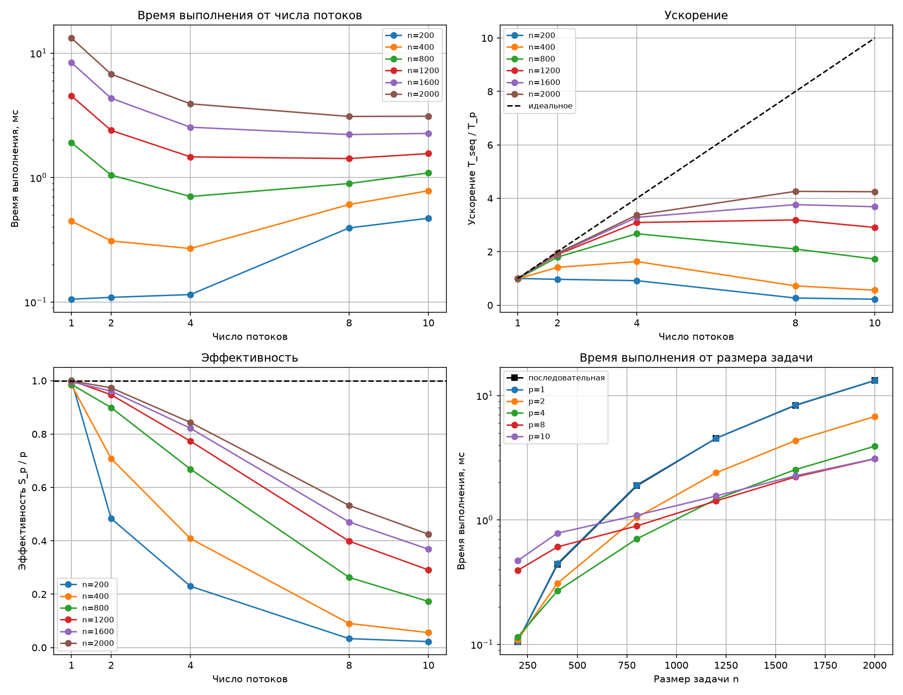

# Лабораторная работа №2. Метод Якоби для решения СЛАУ (OpenMP)

> Дисциплина: Параллельное программирование
> Автор: _(Крипаков Егор, 6213-100503D)_
> Дата: _(14.10.2026)_

## 1. Задание

Модифицировать программу из лабораторной работы №1 (метод Якоби для решения
СЛАУ `Ax = b`) для параллельной работы по технологии OpenMP. Провести серию
экспериментов:

- с разным количеством потоков (1, 2, 4, 8 и т.д.);
- с разными размерами задачи (примерно 200, 400, 800, 1200, 1600, 2000);
- с разным количеством вычислительных ядер при наличии технической
  возможности, иначе использовать фиксированное существующее количество ядер.

В качестве вычислительной задачи, как и в лабораторной работе №1, выбран метод
Якоби (на основании пункта задания, допускающего выбор любой другой
распараллеливаемой задачи). Размер задачи — порядок системы `n`.

## 2. Реализация

В каждой итерации метода Якоби значение `x_new[i]` вычисляется только по
вектору предыдущей итерации `x`, поэтому итерации внешнего цикла по `i`
независимы и распараллелены директивой:

```cpp
#pragma omp parallel for reduction(+ : diff_sq) schedule(static)
for (int i = 0; i < n; ++i) { ... }
```

Особенности реализации:

- Норма разности `||x_new - x_old||` (критерий останова) вычисляется в том же
  цикле через редукцию `reduction(+ : diff_sq)`, отдельного прохода по вектору
  нет.
- Векторы `x` и `x_new` меняются местами обменом указателей, без копирования.
- Внутренний цикл по `j` разбит на два (`j < i` и `j > i`), вместо проверки
  `if (j != i)` в теле цикла.
- Число потоков задаётся пятым аргументом командной строки
  (`./jacobi_omp input.txt output.txt eps max_iter threads`), фактическое
  значение записывается в выходной файл (`threads <p>`).
- Последовательная версия `jacobi_seq` собирается из того же `jacobi.cpp` без
  флага `-fopenmp` (директивы игнорируются). Ускорение считается относительно
  неё: `S_p = T_seq / T_p`, эффективность `E_p = S_p / p`.

Алгоритм, формат входных и выходных данных и способ верификации не изменились
по сравнению с лабораторной работой №1.

## 3. Исходный код

- [`jacobi.cpp`](./jacobi.cpp) — решатель (OpenMP / последовательная сборка)
- [`generate_data.py`](./generate_data.py) — генератор тестовых СЛАУ
- [`verify.py`](./verify.py) — верификация через NumPy
- [`benchmark_omp.py`](./benchmark_omp.py) — серия экспериментов, CSV и графики
- [`Makefile`](./Makefile) — сборка

Инструкция по сборке и запуску — см. [`README.md`](./README.md).

## 4. Условия проведения экспериментов

- Процессор: **Apple M4** (10 ядер)
- ОС: **macOS 15.6**
- Компилятор: **Apple clang** с библиотекой **libomp** (Homebrew), флаги
  `-O2 -std=c++17 -Wall -Wextra -Xpreprocessor -fopenmp`
- Данные: `generate_data.py`, `seed = 42`, коэффициент диагонального
  доминирования 2.0, `eps = 1e-8`, `max_iter = 100000`
- Размеры задачи: `n = 200, 400, 800, 1200, 1600, 2000`
- Число потоков: `p = 1, 2, 4, 8, 10`
- Для каждой конфигурации: один прогревочный запуск и 10 замерных; в таблицах
  приведена **медиана** времени (минимумы также сохранены в `results.csv`)
- Время замеряется через `std::chrono::high_resolution_clock` вокруг цикла
  итераций, без учёта чтения и записи файлов

Количество физических ядер в эксперименте фиксировано (10): в macOS нет
штатного способа ограничить процесс заданным числом ядер, поэтому варьировалось
число потоков OpenMP. Закрепить потоки за конкретными ядрами также нельзя.

## 5. Результаты экспериментов

Полные данные — [`results.csv`](./results.csv), получены запуском
`python3 benchmark_omp.py`.

### 5.1 Время выполнения, мс

| n | Итераций | T_seq, мс | p=1 | p=2 | p=4 | p=8 | p=10 |
|---|---|---|---|---|---|---|---|
| 200 | 8 | 0.1054 | 0.1053 | 0.1090 | 0.1148 | 0.3937 | 0.4712 |
| 400 | 8 | 0.4389 | 0.4460 | 0.3098 | 0.2688 | 0.6072 | 0.7835 |
| 800 | 7 | 1.8835 | 1.9098 | 1.0473 | 0.7043 | 0.8955 | 1.0905 |
| 1200 | 7 | 4.5363 | 4.5365 | 2.3941 | 1.4662 | 1.4219 | 1.5588 |
| 1600 | 7 | 8.3452 | 8.3824 | 4.3421 | 2.5390 | 2.2168 | 2.2644 |
| 2000 | 7 | 13.2019 | 13.2151 | 6.7823 | 3.9131 | 3.0984 | 3.1086 |

Число итераций во всех версиях при одинаковом `n` совпало.

### 5.2 Ускорение S_p = T_seq / T_p

| n | p=1 | p=2 | p=4 | p=8 | p=10 |
|---|---|---|---|---|---|
| 200 | 1.00 | 0.97 | 0.92 | 0.27 | 0.22 |
| 400 | 0.98 | 1.42 | 1.63 | 0.72 | 0.56 |
| 800 | 0.99 | 1.80 | 2.67 | 2.10 | 1.73 |
| 1200 | 1.00 | 1.89 | 3.09 | 3.19 | 2.91 |
| 1600 | 1.00 | 1.92 | 3.29 | 3.76 | 3.69 |
| 2000 | 1.00 | 1.95 | 3.37 | 4.26 | 4.25 |

### 5.3 Эффективность E_p = S_p / p

| n | p=1 | p=2 | p=4 | p=8 | p=10 |
|---|---|---|---|---|---|
| 200 | 1.00 | 0.48 | 0.23 | 0.03 | 0.02 |
| 400 | 0.98 | 0.71 | 0.41 | 0.09 | 0.06 |
| 800 | 0.99 | 0.90 | 0.67 | 0.26 | 0.17 |
| 1200 | 1.00 | 0.95 | 0.77 | 0.40 | 0.29 |
| 1600 | 1.00 | 0.96 | 0.82 | 0.47 | 0.37 |
| 2000 | 1.00 | 0.97 | 0.84 | 0.53 | 0.42 |



## 6. Анализ

**Накладные расходы OpenMP.** Время версии с `p = 1` отличается от времени
последовательной версии не более чем на 1.6 % (отношение `T_1 / T_seq` лежит в
диапазоне 0.999–1.016), то есть сама инфраструктура OpenMP почти ничего не
стоит.

**Влияние размера задачи.** Ускорение растёт с ростом `n`. Для `n = 200`
параллельная версия не быстрее последовательной ни при каком `p`
(S = 0.97 при `p = 2`, S = 0.22 при `p = 10`). Для `n = 400`
максимум ускорения достигается при `p = 4` (S = 1.63), при `p = 8` и
`p = 10` версия медленнее последовательной (S = 0.72 и 0.56).
Для `n = 2000` получено максимальное ускорение S = 4.26 при `p = 8`.

**Малые размеры.** При малых `n` время всей работы (8 итераций) составляет
доли миллисекунды, и стоимость организации параллельной области в каждой
итерации (запуск и синхронизация потоков, редукция) становится сопоставимой с
полезной работой. Грубая оценка: для `n = 200`, `p = 8` рост времени относительно
последовательной версии составляет около 36 мкс на итерацию (оценка
предполагает, что время собственно вычислений при этом мало).

**Масштабирование по потокам.** Для `n ≥ 1200` до `p = 4` эффективность
остаётся высокой (E = 0.77–0.84), при `p = 2` — 0.95–0.97.
При переходе от 4 к 8 потокам время уменьшается заметно слабее (для `n = 2000`:
с 3.91 до 3.10 мс), а от 8 к 10 потокам практически не
меняется (3.10 и 3.11 мс); для `n ≤ 1200` при
`p = 10` время даже растёт.

**Возможные причины насыщения** (проверялись не все; это гипотезы):

1. *Пропускная способность памяти.* Одна итерация читает матрицу `A`
   целиком: при `n = 2000` это около 32 МБ. По времени итерации получаем
   оценку эффективной скорости чтения матрицы: 17 ГБ/с для
   последовательной версии, 33 ГБ/с при `p = 2`, 57 ГБ/с при
   `p = 4` и около 72 ГБ/с при `p = 8` и `p = 10` (72.3 и 72.1).
   Совпадение значений при 8 и 10 потоках согласуется с упором в пропускную
   способность памяти. Пиковую пропускную способность на этой машине мы не
   измеряли.
2. *Неоднородные ядра.* У Apple M4 (10 ядер) ядра двух типов —
   производительные и энергоэффективные; закрепить потоки за ядрами нельзя, и
   часть потоков при `p > 4` вероятно попадает на менее быстрые ядра. Это
   согласуется с резким изменением наклона кривых после `p = 4`, но
   специально не проверялось.

## 7. Верификация корректности

Каждая из 36 конфигураций (6 размеров × (последовательная версия + 5 значений
`p`)) проверена скриптом `verify.py` (сравнение с `numpy.linalg.solve`,
допуск на относительную L2-ошибку `1e-4`): во всех случаях результат **OK**.
Число итераций совпадает во всех версиях, максимальная невязка
`||Ax - b||` по всем экспериментам — 8.36e-08.

## 8. Выводы

Метод Якоби успешно распараллелен с помощью OpenMP: параллельный цикл по строкам
матрицы с редукцией для критерия останова. Версия с одним потоком не уступает
последовательной (отличие не более 1.6 %), результаты совпадают с эталоном
NumPy во всех экспериментах.

Эффективность распараллеливания сильно зависит от объёма задачи. Для `n = 200`
ускорения нет, при `n = 400` оно невелико (максимум 1.63 при `p = 4`), для
`n = 800…2000` максимальное ускорение составляет от 2.67 до
4.26. Максимум достигнут для `n = 2000` при 8 потоках
(S = 4.26, E = 0.53); использование 10 потоков не даёт
дополнительного выигрыша. Лучший баланс ускорения и эффективности на этой машине
для крупных задач — 4 потока (S = 3.37, E = 0.84 при `n = 2000`).

Основными ограничивающими факторами, судя по результатам, являются накладные
расходы на параллельную область при малых `n` и, вероятно, пропускная
способность памяти и неоднородность ядер при больших `n`. Для проверки этих
гипотез можно, например, измерить пиковую пропускную способность памяти и
повторить эксперименты на системе с однородными ядрами.
