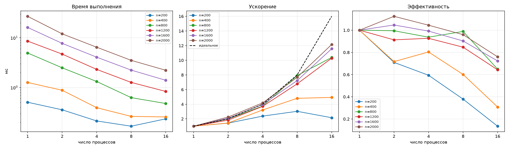

# Лабораторная работа №3. Метод Якоби для решения СЛАУ (MPI)

> Дисциплина: Параллельное программирование
> Автор: _(Крипаков Егор, 6213-100503D)_
> Дата: _(10.11.2026)_

## 1. Задание

Модифицировать программу из лабораторной работы №1 (метод Якоби для решения
СЛАУ `Ax = b`) для параллельной работы по технологии MPI. Провести серию
экспериментов с разными размерами матриц (примерно 200, 400, 800, 1200, 1600,
2000) и разным количеством вычислительных ядер (1, 2, 4, 8 и т.д.).
Параллельную версию необходимо запустить на суперкомпьютере «Сергей Королёв».

Как и в предыдущих работах, вычислительная задача — метод Якоби, размер задачи —
порядок системы `n`.

## 2. Реализация

Используется модель распределённой памяти: матрица `A` разбивается по строкам
между процессами, каждый процесс хранит только свой блок строк и соответствующую
часть вектора `b`. Вектор приближения `x` хранится целиком на каждом процессе.

Схема работы:

1. Процесс 0 читает `n`, `A` и `b` из файла и проверяет диагональ.
2. Значения `n` и флаг успешного чтения рассылаются через `MPI_Bcast`.
3. Строки делятся между `P` процессами так, что блоки отличаются не более чем на
   одну строку (первые `n mod P` процессов получают на строку больше).
   Блоки `A` и `b` раздаются через `MPI_Scatterv`.
4. На каждой итерации каждый процесс вычисляет свою часть `x_new` по полному
   вектору `x` предыдущей итерации и локальную сумму квадратов разности
   `sum (x_new[i] - x[i])^2`.
5. `MPI_Allgatherv` собирает части `x_new` в полный вектор на всех процессах,
   `MPI_Allreduce` с операцией `MPI_SUM` суммирует локальные части нормы.
   Критерий останова `||x_new - x|| < eps` вычисляется одинаково на всех
   процессах, поэтому все процессы выходят из цикла на одной итерации.
6. После цикла невязка `||Ax - b||` считается распределённо и собирается на
   процессе 0 через `MPI_Reduce`, он же записывает результат в файл.

Вектора `x` и `x_new` меняются местами обменом указателей. Формат входных и
выходных данных не изменился; в выходной файл добавлены поля `processes` и
`scatter_ms` (время раздачи данных).

**Замер времени.** Перед циклом итераций и после него стоят `MPI_Barrier`, время
измеряется `MPI_Wtime`. Итоговое `time_ms` — максимум по процессам
(`MPI_Reduce` с `MPI_MAX`). Чтение файла и раздача данных в `time_ms` не входят,
как и в лабораторных №1 и №2.

Ускорение считается относительно запуска этой же MPI-программы на одном
процессе: `S_p = T_1 / T_p`, эффективность `E_p = S_p / p`.

## 3. Исходный код

- [`jacobi_mpi.cpp`](./jacobi_mpi.cpp) — MPI-решатель
- [`generate_data.py`](./generate_data.py) — генератор тестовых СЛАУ
- [`verify.py`](./verify.py) — верификация через NumPy
- [`bench.sbatch`](./bench.sbatch), [`submit_all.sh`](./submit_all.sh) — запуск серии замеров на кластере через Slurm
- [`gen_all.sh`](./gen_all.sh) — генерация входных файлов для всех размеров
- [`analyze.py`](./analyze.py) — обработка результатов, таблицы и графики
- [`Makefile`](./Makefile) — сборка

Инструкция по сборке и запуску — см. [`README.md`](./README.md).

## 4. Условия проведения экспериментов

- Суперкомпьютер: «Сергей Королёв», планировщик Slurm, раздел `batch`.
- Узлы: группа с признаком `mem32` — 16 ядер на узле (2 сокета по 8 ядер),
  32 ГБ ОЗУ, InfiniBand. По данным сайта центра это узлы с процессорами
  Intel Xeon E5-2665; модель процессора на самих узлах не проверялась.
  Задачи попали на узлы n281, n282, n283, n285, n298.
- Запуск: `sbatch --ntasks=P --nodes=1 --exclusive --constraint=mem32`;
  узел выделяется задаче целиком, все серии выполняются на узлах одной группы,
  то есть на одинаковом оборудовании. Все процессы одного запуска находятся на
  одном узле, межузловые обмены не использовались.
- MPI: Intel MPI 4.1.3 (`module load intel/mpi4`), запуск `mpirun -np P`.
  Компилятор — `g++`, вызываемый через `mpicxx`, флаги
  `-O2 -std=c++11 -Wall -Wextra` (на кластере старый `g++` не поддерживает
  `-std=c++17`; программа использует только возможности C++11).
- Данные: `generate_data.py`, `seed = 42`, коэффициент диагонального
  доминирования 2.0, `eps = 1e-6`, `max_iter = 100000`.
- Размеры задачи: `n = 200, 400, 800, 1200, 1600, 2000`.
- Число процессов: `P = 1, 2, 4, 8, 16` (16 — число ядер узла).
- Для каждой конфигурации — 3 запуска, в таблицах приведено **среднее**
  время; минимум и максимум сохранены в `results_summary.csv`. Прогревочных
  запусков не было.

Серия на 32 процессах не проводилась: она потребовала бы двух узлов, и в
замеры вошли бы издержки межузловой сети, не связанные с алгоритмом.

Первая попытка запуска дала неполный `results.csv`: пять задач Slurm шли
одновременно и дописывали строки в один файл, строки перемешались. Результаты
этой попытки не использовались; серия перезапущена, каждая задача пишет в свой
файл `results/res_
.csv`.

## 5. Результаты экспериментов

Исходные замеры — [`results/`](./results), сводка — [`results_summary.csv`](./results_summary.csv),
получена запуском `python3 analyze.py`.

### 5.1 Время выполнения, мс

| n | Итераций | p=1 | p=2 | p=4 | p=8 | p=16 |
|---|---|---|---|---|---|---|
| 200 | 7 | 0.507 | 0.357 | 0.213 | 0.167 | 0.235 |
| 400 | 6 | 1.265 | 0.882 | 0.393 | 0.263 | 0.257 |
| 800 | 6 | 4.960 | 2.493 | 1.323 | 0.627 | 0.478 |
| 1200 | 6 | 8.595 | 4.707 | 2.318 | 1.268 | 0.835 |
| 1600 | 6 | 16.194 | 7.735 | 4.081 | 2.242 | 1.399 |
| 2000 | 6 | 27.039 | 12.017 | 6.471 | 3.521 | 2.225 |

### 5.2 Ускорение S_p = T_1 / T_p

| n | p=1 | p=2 | p=4 | p=8 | p=16 |
|---|---|---|---|---|---|
| 200 | 1.00 | 1.42 | 2.38 | 3.03 | 2.16 |
| 400 | 1.00 | 1.43 | 3.21 | 4.81 | 4.93 |
| 800 | 1.00 | 1.99 | 3.75 | 7.91 | 10.39 |
| 1200 | 1.00 | 1.83 | 3.71 | 6.78 | 10.29 |
| 1600 | 1.00 | 2.09 | 3.97 | 7.22 | 11.57 |
| 2000 | 1.00 | 2.25 | 4.18 | 7.68 | 12.15 |

### 5.3 Эффективность E_p = S_p / p

| n | p=1 | p=2 | p=4 | p=8 | p=16 |
|---|---|---|---|---|---|
| 200 | 1.00 | 0.71 | 0.59 | 0.38 | 0.14 |
| 400 | 1.00 | 0.72 | 0.80 | 0.60 | 0.31 |
| 800 | 1.00 | 0.99 | 0.94 | 0.99 | 0.65 |
| 1200 | 1.00 | 0.91 | 0.93 | 0.85 | 0.64 |
| 1600 | 1.00 | 1.05 | 0.99 | 0.90 | 0.72 |
| 2000 | 1.00 | 1.12 | 1.04 | 0.96 | 0.76 |

## 6. Анализ

**Влияние размера задачи.** Ускорение растёт с ростом `n`. На 16 процессах для
`n = 2000` получено S = 12.15 (E = 0.76), для `n = 1600` — 11.57, для
`n = 800` — 10.39, для `n = 400` — 4.93, для `n = 200` — 2.16.

**Малые размеры.** При `n = 200` и `n = 400` время всей работы — доли
миллисекунды (6–7 итераций), и стоимость коллективных операций на каждой
итерации (`MPI_Allgatherv`, `MPI_Allreduce`) сопоставима с полезными вычислениями.
Для `n = 200` увеличение числа процессов с 8 до 16 приводит к росту времени
(0.167 → 0.235 мс), для `n = 400` время при 8 и 16 процессах практически
одинаково (0.263 и 0.257 мс). Следует учитывать, что на таких малых временах
заметен разброс между запусками: для `n = 200`, `P = 1` значения трёх запусков
лежали в диапазоне 0.386–0.569 мс.

**Крупные размеры.** Для `n ≥ 800` эффективность до 8 процессов остаётся высокой
(0.85–1.12), на 16 процессах снижается до
0.64–0.76: с ростом числа процессов доля времени на обмен вектором `x`
растёт, а объём вычислений на процесс уменьшается.

**Эффективность выше единицы.** Для `n = 1600` (`P = 2`) и `n = 2000`
(`P = 2, 4`) получена эффективность больше 1 (до 1.12). Возможное объяснение — кэш:
блок матрицы, приходящийся на процесс, меньше и лучше помещается в кэш, чем вся
матрица у одного процесса. Это предположение специально не проверялось.
Отдельные значения для средних `n` (например, `n = 800`, `P = 8`: E = 0.99,
выше соседних) могут быть следствием шума: серий всего по 3 запуска, а в отдельных
конфигурациях один запуск заметно выбивается (например, `n = 400`, `P = 2`:
0.66, 0.66 и 1.32 мс), что влияет на среднее.

## 7. Верификация корректности

Число итераций не зависит от числа процессов: для каждого
`n` оно одинаково во всех запусках (7 для `n = 200`, 6 для остальных размеров).
Максимальная невязка `||Ax - b||` по всем замерам на кластере — 1.17e-05.

Сверка с `numpy.linalg.solve` скриптом `verify.py` (допуск на относительную
L2-ошибку `1e-4`) выполнена:

- на кластере — для `n = 200`, `P = 4`: результат **OK**;
- на локальной машине (macOS, OpenMPI 5.0.11) — для `n = 200, 400, 800, 2000` и
  `P = 1, 2, 3, 4, 8`: во всех 20 конфигурациях результат **OK**.

Для остальных конфигураций серии на кластере выходные файлы с решением не
сохранялись (в `results/` остаются только метрики), поэтому сверка с NumPy для
них не проводилась; об их корректности свидетельствуют совпадающее число
итераций и невязка, не превышающая 1.17e-05.

## 8. Выводы

Метод Якоби распараллелен с помощью MPI: строки матрицы распределяются между
процессами, на каждой итерации выполняются сбор вектора `x`
(`MPI_Allgatherv`) и редукция нормы разности (`MPI_Allreduce`). Программа
запущена на суперкомпьютере «Сергей Королёв» через Slurm, результаты
проверены на корректность.

Эффективность сильно зависит от размера задачи. Для `n = 200` выгода от
параллелизма достигается только до 8 процессов (S = 3.03), при 16 процессах
время ухудшается. Для `n = 2000` время уменьшилось с 27.0 мс на одном процессе до
2.2 мс на 16 (S = 12.15, E = 0.76). Ускорение приближается к линейному при
малом числе процессов и крупных задачах, а при росте числа процессов и малых
`n` его ограничивает стоимость коллективных обменов.

Ограничения эксперимента: по 3 запуска на конфигурацию, один узел (до 16
процессов), без прогревочных запусков; причины отклонений от линейного
ускорения (стоимость обменов, кэш) указаны как предположения и отдельными
измерениями не подтверждались.
